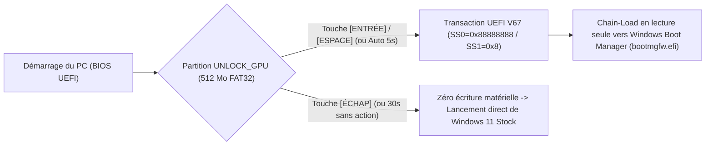

# UNLOCK_GPU_DUALBOOT — Gestionnaire Universel de Partition Dual-Boot UEFI (Sans Clé USB)

[](https://www.gnu.org/licenses/old-licenses/gpl-2.0.en.html)
[]()
[]()

**`UNLOCK_GPU_DUALBOOT.exe`** est une application Windows 64 bits native **100 % autonome (Single-File `.EXE` tout-en-un)** qui permet de créer, gérer et sélectionner au démarrage une partition **Dual-Boot UEFI isolée (`512 Mo FAT32`)** dédiée au déverrouillage pré-pilote des Tensor Cores NVIDIA (**Séries RTX 20 Turing, RTX 30 Ampere et RTX 40 Ada Lovelace**), **sans clé USB** et **sans jamais modifier ni mettre en péril la partition EFI ou le démarrage de Windows 11**.

---

## Crédits, Sources Officielles & Remerciements

Ce projet d'intégration Dual-Boot Windows s'appuie directement sur les travaux remarquables de recherche matérielle, d'ingénierie UEFI et de rétro-ingénierie de la communauté open-source :

1. **Moteur UEFI & Sonde Matérielle Principale (`nv-uefi-unlocker` v2.1.6)** :
   * **[physicsdolphin/nv-uefi-unlocker](https://github.com/physicsdolphin/nv-uefi-unlocker)** par **[@physicsdolphin](https://github.com/physicsdolphin)** — Auteur du chargeur UEFI pré-pilote `BOOTX64.EFI` (Rust `x86_64-unknown-uefi`), de la sonde de registres MMIO `ssdiag-x86_64-windows.exe` et du générateur d'actifs vérifiés par SHA-256 `assets-x86_64-windows.exe`.
   * Vidéos explicatives de l'auteur original sur l'architecture matérielle : [Présentation Bilibili](https://www.bilibili.com/video/BV1d6xN66ECM/) | [Analyse Technique Approfondie](https://www.bilibili.com/opus/1264436370549506065).
2. **Outils de Benchmark Tensor Core & Déverrouillage Power Limit** :
   * **[Skyworks-Neo/nvoc](https://github.com/Skyworks-Neo/nvoc)** par **[@physicsdolphin](https://github.com/physicsdolphin)** (`cli-stressor-cuda-rs`).
3. **Travaux Amont, Correctifs PCIe / GOP & Recherche Communautaire** :
   * **[@8bit2qubit](https://github.com/8bit2qubit)** ([PR #5 sur `nv-uefi-unlocker`](https://github.com/physicsdolphin/nv-uefi-unlocker/pull/5)) — Découverte et correction du bug *Bus Master Enable* (`BRIDGE-BME`) sur les ponts PCIe amont en phase UEFI DXE (corrigeant l'erreur `booter status 0x89`).
   * **Contributeurs [PR #13 sur `nv-uefi-unlocker`](https://github.com/physicsdolphin/nv-uefi-unlocker/pull/13)** — Correction de la réinitialisation plateforme sur les firmwares BIOS AMI Aptio V possédant un sous-handle GOP sans chemin (`pathless GOP`).
   * **[xrip/cmp50hx-unlock](https://github.com/xrip/cmp50hx-unlock)** par **[@xrip](https://github.com/xrip)** — Archive de référence `GspRmBoot` (`gsp_rm_boot_dbg.bin`) utilisée pour la chaîne `BOOT_DIRECT` des architectures Turing (`TU10x`).
   * **[chungtair/rtx4060ti-auto-unlock](https://github.com/chungtair/rtx4060ti-auto-unlock)** par **[@chungtair](https://github.com/chungtair)** ainsi que les chercheurs et testeurs matériels cités en amont (`@vadash`, `@hunan-NRT`, `chenxluo`, `nlzy`, `haohervchb`).
   * **[NVIDIA/open-gpu-kernel-modules](https://github.com/NVIDIA/open-gpu-kernel-modules)** (`610.43.03`) — Sources publiques officielles NVIDIA utilisées pour l'extraction vérifiée par SHA-256.

---

## 1. Principe Technique : Pourquoi le Démarrage de Windows 11 est 100 % Protégé

Sur les architectures NVIDIA Turing (RTX 20), Ampere (RTX 30) et Ada Lovelace (RTX 40), la limitation du débit d'émission des Tensor Cores (ex: `FP16` avec accumulation `FP32`) est verrouillée par un masque matériel de privilège (`PLM`, par défaut `0xffffff8f`) avant le chargement du pilote du système d'exploitation.

Au lieu d'exiger une clé USB branchée en permanence ou de modifier la partition EFI critique de Windows (`\EFI\Microsoft\Boot\bootmgfw.efi`), **`UNLOCK_GPU_DUALBOOT.exe`** met en œuvre une architecture **Dual-Boot totalement isolée** :



1. **Isolation physique de la partition** :
   * **La partition EFI de Windows 11 (`\EFI\Microsoft\Boot\bootmgfw.efi`) et le chargeur `{bootmgr}` ne sont JAMAIS modifiés.**
   * L'outil réduit proprement via l'API native Windows WMI Storage (`MSFT_Partition.Resize`) la fin d'un volume existant (en priorité un disque secondaire comme `D:`, ou la fin de `C:` sur un PC à disque unique) de seulement **512 Mo**, et y crée une partition **`FAT32`** indépendante nommée **`UNLOCK_GPU`**.
2. **Chaînage automatique vers Windows 11** :
   * Dès que `BOOTX64.EFI` a terminé le déverrouillage (ou si vous appuyez sur `ÉCHAP` pour démarrer sans déverrouillage), il recherche automatiquement `\EFI\Microsoft\Boot\bootmgfw.efi` sur votre disque système et lance **Windows 11**.
3. **Réversibilité totale en 1 clic** :
   * Le bouton **[Supprimer Partition & Refusionner]** supprime l'entrée UEFI, supprime la partition `UNLOCK_GPU` de 512 Mo et ré-étend immédiatement votre disque d'origine (`D:` ou `C:`) pour lui restituer 100 % des 512 Mo.

---

## 2. Fonctionnalités de l'Exécutable Autonome (`UNLOCK_GPU_DUALBOOT.exe`)

* **100 % Autonome (Single-File `.EXE` de ~70 Mo)** :
  Embarque directement dans ses ressources internes compressées :
  * `BOOTX64.EFI` (`295 Ko`),
  * Les 7 binaires signés `AD102` pour toute la **Série RTX 40** (fonctionne **100 % hors-ligne** sans Internet),
  * `ssdiag-x86_64-windows.exe` (sonde matérielle des registres BAR0 `SS0`/`SS1`),
  * `assets-x86_64-windows.exe` et `make-usbroot.ps1` (pour générer automatiquement les firmwares des **Séries RTX 30 `GA102`** et **RTX 20 `TU10X`**).
* **100 % Universel (Multi-PC & Multi-GPU)** :
  * Détecte automatiquement le modèle exact de votre carte NVIDIA (`VEN_10DE&DEV_xxxx`), son slot de registre (`0000`, `0001`...) et sa famille (`AD102`, `GA102`, `TU10X`).
  * Compatible avec les PC possédant **plusieurs disques** (`D:`, `E:`...) comme avec les PC portables ou fixes n'ayant qu'**un seul disque (`C:`)**.
  * **Scan PCIe Universel** activé par défaut : détecte automatiquement le slot PCIe de la carte graphique au démarrage, quelle que soit la carte mère (Intel ou AMD).
* **Conforme Microsoft Defender (`0 menace détectée`)** :
  * Repose exclusivement sur l'API native `.NET System.Management` (`\\.\root\Microsoft\Windows\Storage`) et un manifeste UAC officiel (`app.manifest`).

---

## 3. Guide d'Utilisation Pas-à-Pas

### Étape 1 — Prérequis Unique dans le BIOS UEFI
Dans les réglages de votre BIOS UEFI :
* **`Secure Boot`** : **`Disabled`** (Désactivé — requis pour exécuter `BOOTX64.EFI`).
* **`Fast Boot`** : **`Disabled`** (Désactivé).
* *(Sur PC portable hybride Optimus / MUX)* : Utilisez toujours **"Redémarrer"** depuis Windows (ou activez le mode **`dGPU Only` / `Ultimate`** si disponible) afin que la carte graphique dédiée soit alimentée lors du passage en UEFI.

### Étape 2 — Lancer `UNLOCK_GPU_DUALBOOT.exe`
Téléchargez et double-cliquez sur **`UNLOCK_GPU_DUALBOOT.exe`** (aucun autre fichier n'est nécessaire) :

1. **Choix du Volume & du Mode** :
   * Sélectionnez le volume sur lequel prélever **512 Mo** (le disque secondaire `D:` est sélectionné automatiquement s'il existe, sinon `C:`).
   * Choisissez le comportement de l'écran UEFI au démarrage :
     * **Mode Dual-Boot Interactif (Recommandé)** : À l'écran UEFI, appuyez sur **`ENTRÉE` / `ESPACE`** pour déverrouiller le GPU et lancer Windows, ou sur **`ÉCHAP`** pour lancer Windows 11 normal.
     * **Mode Automatique 5 secondes** : Déverrouille tout seul après un compte à rebours de 5 secondes et lance Windows automatiquement (`ÉCHAP` annule).
2. **Bouton `[1] Créer / Mettre à jour la Partition UNLOCK_GPU (512 Mo) + Entrée Dual-Boot UEFI`** :
   * Crée la partition `FAT32` de 512 Mo, extrait et vérifie physiquement tous les fichiers binaires, configure le maintien continu Windows (`HiberbootEnabled=0` et `DisableDynamicPstate=1` anti-`D3cold`), et enregistre l'entrée UEFI **`UNLOCK_GPU (NVIDIA UEFI Dual-Boot)`** tout en maintenant **Windows 11 en position N°1 par défaut**.
3. **Choisissez comment démarrer sur `UNLOCK_GPU`** :
   * **Bouton `[2] REDÉMARRER EN MODE UNLOCK_GPU (1 seul boot via BootNext -> Windows)`** :
     Programme la variable UEFI `BootNext` pour **un seul redémarrage**. Le PC redémarre sur `UNLOCK_GPU`, déverrouille la carte graphique et lance Windows 11. Pour tous les démarrages suivants, Windows 11 reste le démarrage normal par défaut.
   * **Bouton `[3] Activer le Choix Dual-Boot à CHAQUE Démarrage`** :
     Place `UNLOCK_GPU` en position N°1 dans l'ordre de démarrage UEFI pour vous proposer le choix à chaque allumage du PC, exactement comme un Dual-Boot classique.
   * **Bouton `[4] Remettre Windows Direct par Défaut en N°1`** :
     Remet immédiatement `Windows Boot Manager` en N°1 par défaut.
4. **Vérification sous Windows** :
   * Au retour sous Windows, relancez **`UNLOCK_GPU_DUALBOOT.exe`** : l'état matériel affiche :
     **`DÉVERROUILLÉ 100% FULL-RATE (SS0=0x88888888)`**.
   * Vous pouvez également cliquer sur **`Lire le Journal UEFI (loader.log)`** pour consulter la trace complète de la transaction UEFI.

---

## 4. Désinstallation Complète et Retour 100 % d'Origine

À tout moment, depuis **`UNLOCK_GPU_DUALBOOT.exe`** :
1. Cliquez sur **`[Supprimer Partition & Refusionner]`** :
   * Supprime l'entrée UEFI de la NVRAM et remet `Windows Boot Manager` en N°1.
   * Supprime la partition `UNLOCK_GPU` de 512 Mo.
   * Ré-étend automatiquement votre volume d'origine (`D:` ou `C:`) pour lui rendre l'intégralité des 512 Mo.
2. Cliquez sur **`[Restaurer Alimentation Windows Stock]`** :
   * Remet `HiberbootEnabled=1` et supprime `DisableDynamicPstate`.

---

## 5. Compilation depuis le Code Source (`DualBootUnlockManager.cs`)

Le code source C# complet est fourni dans [`DualBootUnlockManager.cs`](DualBootUnlockManager.cs) et utilise le compilateur natif de Windows (`.NET Framework 4.8`) sans nécessiter Visual Studio :

```powershell
& "C:\Windows\Microsoft.NET\Framework64\v4.0.30319\csc.exe" `
    /target:winexe /platform:x64 /optimize+ `
    /r:System.Management.dll `
    /win32manifest:"app.manifest" `
    /resource:"embedded_payload.gz",UnlockPayload.gz `
    /out:"UNLOCK_GPU_DUALBOOT.exe" `
    "DualBootUnlockManager.cs"
```

---

## Licence & Avertissement

* **Licence** : Distribué sous licence **[GPL-2.0-only](nv-uefi-unlocker/LICENSE)** conformément au projet amont [physicsdolphin/nv-uefi-unlocker](https://github.com/physicsdolphin/nv-uefi-unlocker).
* **Avertissement Matériel** : Le déverrouillage du taux d'émission des Tensor Cores est **100 % volatil** (aucune modification du VBIOS ni flash persistant : une coupure d'alimentation remet la carte à 100 % dans son état d'usine). Toutefois, l'activation de l'ensemble des unités de calcul augmente la consommation électrique et la dissipation thermique de la carte graphique lors des charges intensives (IA / FP16 GEMM). Surveillez toujours vos températures (*Hot Spot* / VRAM) et votre alimentation.
